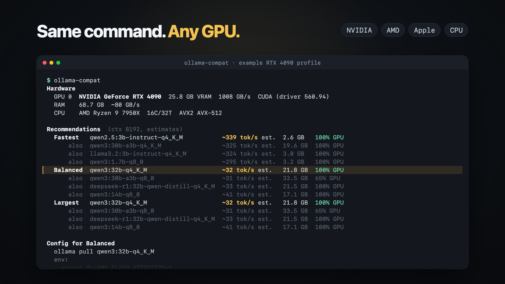

# ollama-compat

Find out which Ollama models your machine can run, and how fast.

[](docs/assets/demo.mp4)

*Click to watch the 20-second intro (with sound). The RTX 4090 scene is
real output for an example hardware profile.*

`ollama-compat` scans your hardware (GPU, VRAM, memory bandwidth, RAM, CPU),
estimates decode speed for a curated catalog of open-weight models, and
recommends a fast, a balanced and a largest-that-fits pick. It also prints a
ready-to-use Ollama config for the balanced pick. It is a single static
binary with no runtime dependencies.

By default it makes no network calls. The optional `bench` command measures
real speed through a local Ollama server.

New here? Follow the step-by-step
**[Getting started guide](docs/getting-started.md)**: it covers installing
Ollama and this tool on macOS, Linux and Windows, reading the output,
applying the config, and troubleshooting.

## Quick start

```bash
# 1. Build (needs Go 1.24+ and git); or download a release, see Install below
git clone https://github.com/shra26/ollama-compatibility-checker.git
cd ollama-compatibility-checker
go build -o ollama-compat ./cmd/ollama-compat

# 2. Get recommendations (offline, about one second)
./ollama-compat

# 3. Use the Balanced pick (copy the exact commands from your output)
ollama pull <tag from the output>
# save the Modelfile lines from the output to a file named Modelfile, then:
ollama create <name from the output> -f Modelfile
ollama run <name from the output> --verbose
```

On Windows, build with `go build -o ollama-compat.exe ./cmd/ollama-compat`
and run `.\ollama-compat.exe`.

## Install

### Prebuilt binaries

Download the archive for your platform from
[GitHub Releases](https://github.com/shra26/ollama-compatibility-checker/releases),
unpack it and put `ollama-compat` on your `PATH`. Builds exist for Linux,
macOS and Windows on amd64 and arm64 (use `darwin_arm64` for Apple Silicon
Macs and `windows_amd64` for most Windows PCs). If no release is listed yet,
build from source.

On macOS, a downloaded binary may be blocked by Gatekeeper. Clear the
quarantine flag once:

```bash
xattr -d com.apple.quarantine ollama-compat
```

On Windows, SmartScreen may warn about an unrecognized app; choose "More
info", then "Run anyway".

### From source

Requires [Go 1.24 or newer](https://go.dev/dl/).

```bash
git clone https://github.com/shra26/ollama-compatibility-checker.git
cd ollama-compatibility-checker
go build -o ollama-compat ./cmd/ollama-compat
```

Or install into your Go bin directory (`~/go/bin`, which must be on your
`PATH`):

```bash
go install github.com/shra26/ollama-compatibility-checker/cmd/ollama-compat@latest
```

### Ollama

`recommend`, `scan` and `catalog` do not need Ollama. To run the recommended
model, or to use `bench`, install Ollama from <https://ollama.com/download>
and make sure it is running (`curl http://127.0.0.1:11434/api/version`).

## Usage

```
ollama-compat [flags]
ollama-compat [command]

Commands:
  recommend   Scan hardware and recommend models (default command)
  scan        Report detected hardware
  catalog     List models in the catalog
  bench       Benchmark the shortlist on a local Ollama (opt-in, may download models)

Flags:
      --catalog string   path to a custom model catalog file
      --ctx int          context length to size the KV cache for (default 8192)
      --json             emit machine-readable JSON
      --min-tps float    Balanced pick must reach this estimated tok/s (default 20)
      --no-color         disable colored output
      --top int          how many alternatives to list per pick (default 3)
  -v, --version          version for ollama-compat
```

Running `ollama-compat` with no command is the same as `ollama-compat recommend`.

### recommend

Scans the hardware, estimates every catalog variant at the chosen context
length, and prints three picks, each with runners-up:

- **Fastest**: highest est. tok/s among models with a quality score of at least 40 that fit fully on the GPU (falls back to partial offload if none fit).
- **Balanced**: highest quality reaching `--min-tps`.
- **Largest**: highest quality reaching at least 5 tok/s, partial offload allowed.

It then prints the Ollama config for the Balanced pick: the `ollama pull`
command, environment variables, a Modelfile and the `ollama create` command.
Environment variable syntax is shown for your OS. How to apply each part on
macOS, Linux (systemd) and Windows is in
[Getting started, step 4](docs/getting-started.md#4-apply-the-recommended-config).

Example output on an Apple M1 with 8 GB of RAM (your numbers will differ):

```
Hardware
  GPU 0  Apple M1  5.7 GB VRAM  68 GB/s  Metal
  RAM    8.6 GB  ~68 GB/s
  CPU    Apple M1  8C/8T

Recommendations  (ctx 8192, estimates)
  Note: Apple Silicon estimates are uncalibrated; an M1 8 GB measured about half the estimate. Run `ollama-compat bench` to measure.
  Fastest   qwen2.5:3b-instruct-q4_K_M   ~23 tok/s est.  2.6 GB  100% GPU
      also  llama3.2:3b-instruct-q4_K_M  ~22 tok/s est.  3.0 GB  100% GPU
      also  qwen3:1.7b-q8_0              ~20 tok/s est.  3.2 GB  100% GPU
      also  phi4-mini:3.8b-q4_K_M        ~18 tok/s est.  3.6 GB  100% GPU
  Balanced  qwen2.5:3b-instruct-q4_K_M   ~23 tok/s est.  2.6 GB  100% GPU
      also  llama3.2:3b-instruct-q4_K_M  ~22 tok/s est.  3.0 GB  100% GPU
      also  qwen3:1.7b-q4_K_M            ~33 tok/s est.  2.4 GB  100% GPU
      also  granite3.3:2b                ~29 tok/s est.  2.4 GB  100% GPU
  Largest   qwen3:8b-q4_K_M              ~8 tok/s est.   6.4 GB  75% GPU
      also  qwen3:4b-q8_0                ~10 tok/s est.  5.5 GB  86% GPU
      also  qwen3:4b-q4_K_M              ~17 tok/s est.  3.8 GB  100% GPU
      also  qwen2.5:7b-instruct-q4_K_M   ~9 tok/s est.   5.5 GB  86% GPU

Config for Balanced
  ollama pull qwen2.5:3b-instruct-q4_K_M
  env:
    export OLLAMA_FLASH_ATTENTION=1
    export OLLAMA_KV_CACHE_TYPE=q8_0
    # OLLAMA_KV_CACHE_TYPE is server-wide and applies to all models.
  env (for the Ollama.app):
    launchctl setenv OLLAMA_FLASH_ATTENTION 1
    launchctl setenv OLLAMA_KV_CACHE_TYPE q8_0
    # OLLAMA_KV_CACHE_TYPE is server-wide and applies to all models.
  Restart Ollama after setting these.
  Modelfile:
    FROM qwen2.5:3b-instruct-q4_K_M
    PARAMETER num_ctx 8192
    PARAMETER num_gpu 99
  ollama create qwen2.5-3b-instruct-q4_K_M-tuned -f Modelfile

Run `ollama-compat bench` to measure these (downloads up to ~7.2 GB, asks first).
```

Useful flags: `--ctx 16384` sizes the KV cache for a longer context,
`--min-tps 30` raises the speed bar for the Balanced pick, `--top 5` lists
more runners-up, `--json` prints machine-readable output.

### scan

Prints only the detected hardware (the first block above). Accepts the global
flags, including `--json`.

### catalog

Lists every model variant in the catalog with its parameter count,
quantization, download size, maximum context and quality score. Use
`--catalog path/to/models.json` on any command to use your own catalog file.

### bench

Measures real tokens per second for the recommended models through a local
Ollama server. This is the only command that downloads data. It shows the
total size and asks before pulling anything.

```
ollama-compat bench [flags]

Flags:
      --allow-remote          allow benchmarking a non-local OLLAMA_HOST
      --installed-only        benchmark only models already installed; downloads nothing
      --keep                  keep models downloaded for the benchmark
      --max-download string   refuse if the total download exceeds this size, for example 20GB
      --runs int              timed runs per model (the median is reported) (default 3)
      --yes                   skip the download confirmation (for scripts)
```

`bench` also accepts `--ctx`, `--min-tps`, `--top` and the global flags
(`--catalog`, `--json`, `--no-color`). It talks to `http://127.0.0.1:11434`,
or to `OLLAMA_HOST` if set. If `OLLAMA_HOST` is not a loopback address,
`bench` refuses unless you pass `--allow-remote`; the measurements then
describe the remote machine, not the one you scanned.

Consent and cleanup:

- Nothing is downloaded without showing the total size and asking
  `[y/N]` (default No). Non-interactive runs refuse to download unless you pass `--yes`.
- Afterwards, on a terminal, it asks "Remove the N models downloaded for this
  benchmark ... [Y/n]" and deletes only models it pulled in that run. Models
  you already had are never removed.
- With `--yes`, or when there is no terminal, it never deletes anything and
  prints the `ollama rm <tag>` commands instead.
- `--keep` skips the question and keeps the downloaded models.
- Ctrl+C at the download prompt downloads nothing; at the cleanup prompt nothing is deleted and the downloaded models are listed with `ollama rm` commands.

Examples:

```bash
ollama-compat bench --installed-only          # measure what you already have
ollama-compat bench --max-download 10GB       # refuse if more than 10 GB is needed
ollama-compat bench --json > bench.json       # keep the results
```

## How estimates work

Token generation (decode) is limited by memory bandwidth: every generated
token reads the active weights once. The tool computes:

1. **Memory needed** = model file size + KV cache for your context length + 0.5 GB runtime overhead.
2. **GPU fraction** = how much of that fits in usable VRAM (VRAM minus 10 percent headroom), rounded to whole layers. On Apple Silicon the GPU shares system RAM, so usable memory is about 66 percent of RAM (75 percent above 36 GB).
3. **Speed** = 1 / (time on GPU + time on CPU), where each time is the bytes read per token divided by memory bandwidth times an efficiency factor (0.65 for GPU, 0.55 for CPU). For mixture-of-experts models only the active parameters count.

Bandwidth comes from lookup tables of known GPUs and chips, not from a
measurement. Models that cannot fit in VRAM plus 80 percent of RAM are
excluded.

Estimates are a rough guide (target within about plus or minus 30 percent,
not yet met on every machine). The one Apple Silicon machine measured so far
(M1, 8 GB) ran at about half the estimated speed; other machines are not yet
measured. Offloaded models, unknown GPUs (marked low confidence) and unusual
drivers can be further off. Run `ollama-compat bench` to measure the real
number on your machine. See `catalog/README.md` for the calibration log.

Quality scores in the catalog are maintainer-curated estimates, not benchmark
results; see `catalog/README.md`.

## Privacy

A default run (`recommend`, `scan`, `catalog`) makes no network calls. It reads
local hardware information and a catalog compiled into the binary. `bench`
only talks to your local Ollama server and asks before downloading anything.
Nothing is uploaded anywhere.

## Supported hardware

| Hardware | Backend | Notes |
|---|---|---|
| NVIDIA | CUDA | Compute capability 5.0 or newer, detected through `nvidia-smi` |
| AMD | ROCm | Only ROCm-supported gfx targets are treated as GPU |
| Apple Silicon | Metal | Unified memory; M1 through current chips |
| Intel GPUs, unsupported AMD GPUs | none | Estimated as CPU; Ollama's Vulkan backend may do better |
| CPU only | none | Estimated from system RAM bandwidth |

Platforms: Linux, macOS and Windows, on amd64 and arm64. If a GPU is not in the
bandwidth table, the tool uses a heuristic by vendor and VRAM size and marks
the result low confidence.

## Contributing calibration data

The efficiency constants are starting values and improve with real
measurements. If you have a machine to spare:

1. Run `ollama-compat bench --json > bench.json`.
2. Open an issue and paste the file. It contains your hardware, the estimate and the measured speed for each model. Review it first; nothing is uploaded by the tool.

Issues adding missing GPUs to the bandwidth table are welcome too.

## Regenerating the catalog

`internal/catalog/models.json` is generated from the hand-maintained
`catalog/sources.yaml`. The generator needs network access to
`registry.ollama.ai` and is a development tool only:

```bash
go run ./scripts/gen-catalog -in catalog/sources.yaml -out internal/catalog/models.json
```

See `catalog/README.md` for where each field comes from.

## Troubleshooting

Common problems (GPU not detected, Ollama not reachable, slow speeds, Windows
colors, macOS Gatekeeper) are covered in
[Getting started: Troubleshooting](docs/getting-started.md#troubleshooting).

## Development

```bash
go test ./...
go vet ./...
go build -o ollama-compat ./cmd/ollama-compat
```

Project layout:

| Path | Contents |
|---|---|
| `cmd/ollama-compat` | CLI commands (cobra) |
| `internal/hw` | Hardware detection per vendor and OS |
| `internal/catalog` | Embedded model catalog and loader |
| `internal/estimate` | Memory fit and tok/s estimator |
| `internal/recommend` | Picks and Ollama config generation |
| `internal/output` | Text and JSON rendering |
| `internal/bench` | Ollama API client and the bench flow |
| `scripts/gen-catalog` | Catalog generator (dev only) |
| `docs/` | Getting started guide, design spec and implementation plan |

Releases are built by GoReleaser when a `v*` tag is pushed:

```bash
git tag v0.1.0
git push origin v0.1.0
```

## License

MIT. See `LICENSE`.
